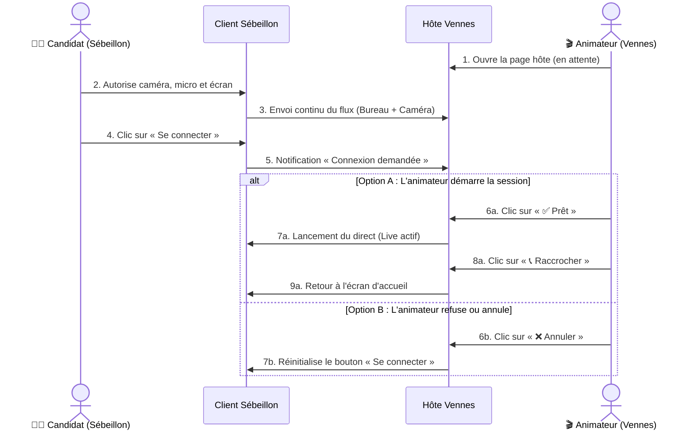
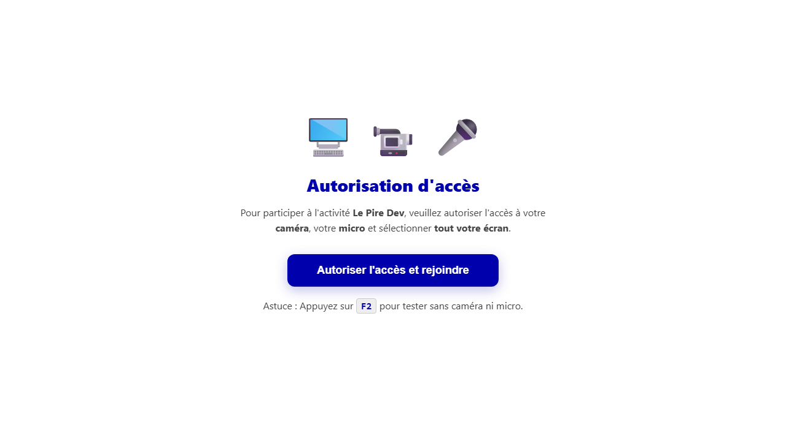
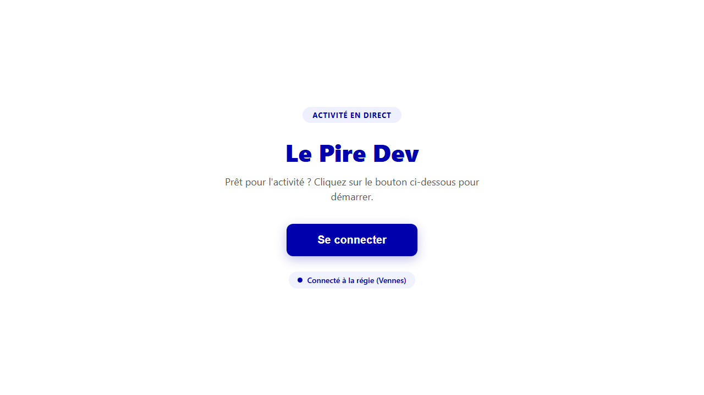
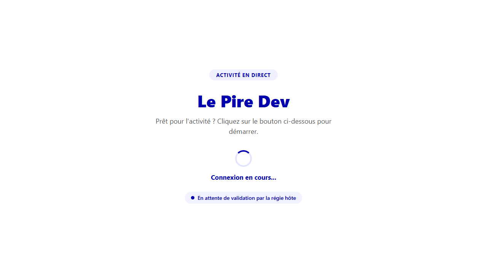
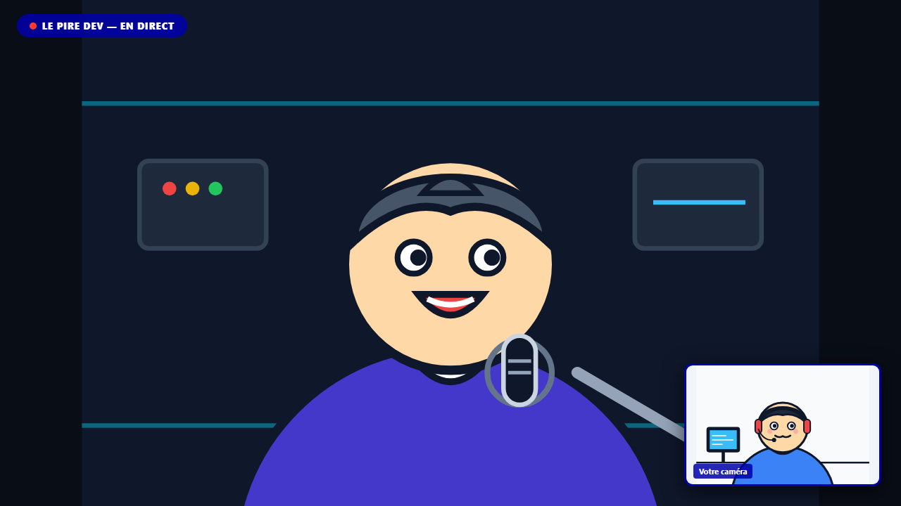
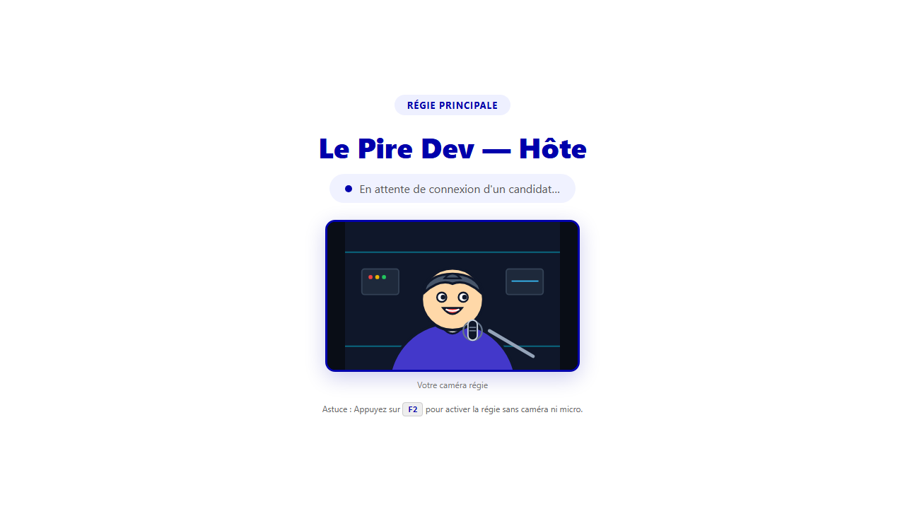
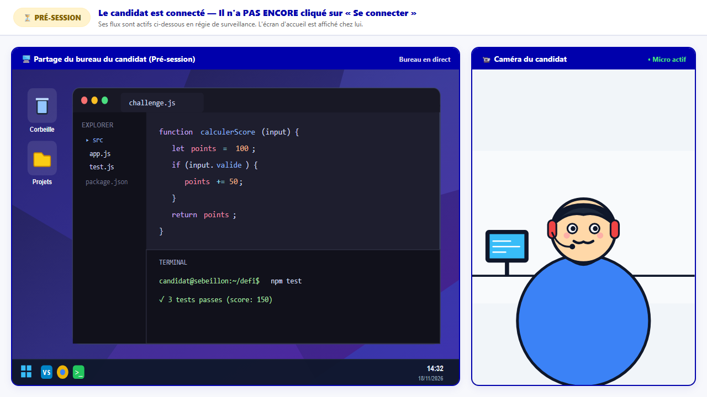
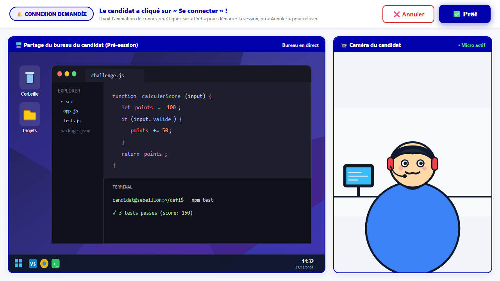
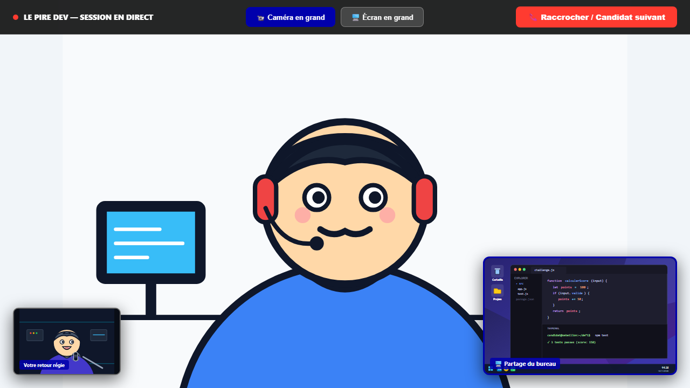

# Guide d'utilisation : Le Pire Dev
**Interconnexion Sébeillon (Candidat) & Vennes (Hôte)**

Ce guide détaille pas à pas le déroulement d'une session de défi en direct entre le poste du candidat (site de **Sébeillon**) et le poste hôte de surveillance et d'animation (site de **Vennes**).

---

## Vue synoptique du déroulement

---

## Partie 1 : Déroulement côté Sébeillon (Candidat / Client)

> **Lien d'accès :** `https://naelvuille.github.io/Visio-LePireDev/`

### Étape 1 : Autorisation des périphériques

À l'ouverture du lien, le navigateur affiche une modale claire d'accueil demandant les autorisations nécessaires à l'épreuve :
1. Cliquez sur le bouton bleu **« Autoriser l'accès et rejoindre »**.
2. Le navigateur demandera l'accès à la **caméra** et au **micro** (cliquez sur *Autoriser*).
3. Le navigateur ouvrira la fenêtre de partage d'écran : **choisissez « Tout l'écran »** afin que l'hôte puisse voir le bureau et les fenêtres.
*(En cas de poste sans webcam/micro, la touche **`F2`** active un mode de secours silencieux).*

---

### Étape 2 : Écran d'accueil et attente du signal

Une fois les autorisations validées, le candidat arrive sur une page d'attente sobre et propre.
- Le badge vert/bleu en bas indique **« Connecté à l'hôte (Vennes) »**.
- **Important :** À ce moment-là, le partage d'écran et la webcam tournent déjà discrètement vers le poste hôte de Vennes pour vérification technique, mais l'épreuve n'a pas encore démarré.
- Le candidat attend le signal des organisateurs avant de cliquer.

---

### Étape 3 : Demande de connexion

Au signal de l'animateur, le candidat clique sur **« Se connecter »** :
- Le bouton laisse place à un spinner animé avec la mention **« Connexion en cours... »**.
- L'hôte à Vennes reçoit immédiatement une alerte prioritaire.
- Le candidat attend quelques secondes que l'hôte valide son passage au direct.

---

### Étape 4 : Session Live en direct

Dès que l'hôte clique sur « Prêt » :
- L'interface bascule instantanément en plein écran avec le bandeau gris supérieur **« 🔴 LE PIRE DEV — SESSION EN DIRECT »**.
- Le visage géométrique de l'animateur (Vennes) s'affiche en grand format.
- Le visage géométrique du candidat s'affiche en incrustation (*Picture-in-Picture*) en bas à droite pour garder un retour vidéo.

---

## Partie 2 : Déroulement côté Vennes (Hôte / Plateau)

> **Lien d'accès :** `https://naelvuille.github.io/Visio-LePireDev/hote/`

### Étape 1 : Attente initiale côté hôte

À l'ouverture du lien hôte sur le poste de Vennes :
- Le statut indique **« En attente de connexion d'un candidat… »**.
- Une vignette centrale affiche le retour vidéo de la caméra studio de l'animateur (personnage géométrique avec micro).
- L'hôte écoute en continu l'identifiant PeerJS fixe `ETML-LePireDev-2026`.

---

### Étape 2 : Mode Pré-Session (Surveillance discrète)

Dès que le candidat de Sébeillon valide ses autorisations :
- L'hôte bascule automatiquement sur l'écran **Pré-Session** (bandeau gris supérieur avec badge jaune **« ⏳ PRÉ-SESSION »**).
- **À gauche en grand format :** Le partage d'écran temps réel du bureau complet du candidat (fond d'écran, corbeille, projets, fenêtre de code et terminal).
- **À droite :** Le personnage géométrique du candidat avec casque gamer et indicateur **« Micro actif »**.
- L'animateur peut ainsi vérifier en amont que le code est bien visible et que le micro fonctionne sans que le candidat ne soit dérangé.

---

### Étape 3 : Candidat prêt — Choix de validation ou d'annulation

Quand le candidat clique sur « Se connecter » à Sébeillon :
- Le bandeau supérieur affiche la notification : **« 🔔 CONNEXION DEMANDÉE : Le candidat a cliqué sur « Se connecter » ! »**.
- Deux boutons de contrôle apparaissent à droite du bandeau :
  1. **`✅ Prêt` (Bouton bleu pulsant)** : lance immédiatement le direct vidéo chez les deux participants.
  2. **`❌ Annuler` (Bouton blanc/rouge)** : si l'hôte n'est pas encore prêt ou s'il s'agit d'une fausse manipulation, un clic sur *Annuler* réinitialise l'écran du candidat sur le bouton *Se connecter* sans couper les flux vidéo en coulisse.

---

### Étape 4 : Session Live & Pilotage hôte

Quand l'animateur clique sur **« ✅ Prêt »** :
- Le plateau est en direct !
- **Barre supérieure de contrôle (bandeau gris unifié) :**
  - **`📹 Caméra en grand`** : met le visage du candidat géométrique en plein écran.
  - **`🖥️ Écran en grand`** : met le partage du bureau en plein écran.
  - **`📞 Raccrocher / Candidat suivant`** : termine l'appel live et remet le candidat sur l'accueil, tout en conservant la pré-session active.
- Deux fenêtres de retour sont incrustées en bas : le partage du bureau à droite et le retour caméra hôte à gauche.

---

## Récapitulatif des raccourcis & astuces

| Contexte | Touche / Action | Effet |
| :--- | :--- | :--- |
| **Sans webcam/micro** | <kbd>F2</kbd> (sur Sébeillon ou Vennes) | Génère automatiquement un flux vidéo noir et un audio muet pour tester sans équipement. |
| **Raccrochage live** | Clic sur **`📞 Raccrocher`** | Coupe le live sans déconnecter les flux sous-jacents : le candidat revient sur *Se connecter*. |
| **Refus / Reset attente** | Clic sur **`❌ Annuler`** | Réinitialise la demande du candidat sans recharger la page. |
| **Changement de candidat** | Recharger la page (<kbd>F5</kbd>) ou fermer l'onglet | Libère complètement la session WebRTC pour le candidat suivant. |
